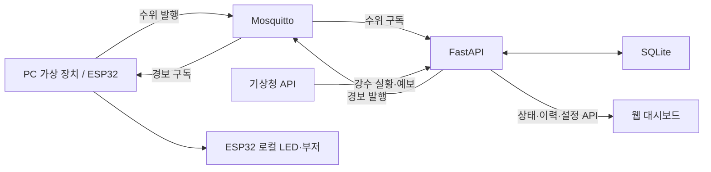

# FLOOD GUARD

저층 상가의 실내 침수를 감지하고, 수위가 피해 기준에 도달하기까지 남은 시간(ETA)을 추정하는 조기 경보 프로토타입입니다. 바닥 접촉과 0·2·4·6·8cm 단계별 수위를 사용합니다. 기상청 강수량은 사전 주의 표시에 활용하며, ETA는 수위 변화로 계산합니다.

## 현재 구현 상태

- **센서 없이 전체 시연 가능** — PC 가상 장치가 하드코딩된 수위를 MQTT로 발행합니다. 서버는 SQLite에 저장하고, 웹은 최신 수위·ETA·강수량·수위 그래프·경보 이력을 표시합니다. 매장 이름, 위험 수위, 경고 기준 시간은 화면에서 바꿀 수 있습니다.
- **기상청 API 호출 확인** — 경기도 군포시 대표 격자(X 59, Y 122)에서 초단기실황과 초단기예보 응답을 확인했습니다. 서버는 시작할 때와 이후 5분마다 조회합니다. 키 없이 실행하면 가상 강수량 48mm를 표시합니다.
- **ESP32 센서 연동 예정** — 현재 펌웨어도 가상 수위값을 사용합니다. 실물 GPIO 센서, 보드 업로드, 현장 LED·부저 동작은 하드웨어를 연결한 뒤 검증할 항목입니다.

## 시스템 구성



발표용 기본 위험 수위는 **8cm**입니다. 최근 상승 속도가 양수일 때 `ETA = (위험 수위 − 현재 수위) / 상승 속도`로 계산합니다. ETA 15분 이내는 경고, 5분 이내나 위험 수위 도달 또는 여러 센서가 동시에 감지되면 긴급입니다. 수위 변화가 없거나 상승 속도를 계산할 수 없으면 ETA를 표시하지 않습니다. 서버가 15초 넘게 센서값을 받지 못하면 마지막 수위와 통신 지연을 표시합니다.

## 빠른 실행

### 1. Docker로 전체 시연

Windows에서는 Docker Desktop을 켠 뒤, 레포 루트에서 실행합니다.

```powershell
docker compose --profile demo up --build
```

- [대시보드](http://localhost:8000) · [API 문서](http://localhost:8000/docs) · [날씨 API](http://localhost:8000/api/stores/store01/weather)
- 장치는 약 4초마다 **건조 → 0cm → 2cm → 6cm → 8cm → 건조**를 반복합니다. 0→2cm 구간에 가상 경과 시간 200초를 적용하므로 화면에 **0.60cm/분, ETA 약 10분**이 표시됩니다.
- `Ctrl+C`로 종료합니다. SQLite 데이터는 Compose의 `readings` 볼륨에 남습니다.

### 2. 실제 기상청 데이터 연결

[공공데이터포털 기상청 단기예보 조회서비스](https://www.data.go.kr/data/15084084/openapi.do)에서 **초단기실황조회**와 **초단기예보조회**를 신청합니다. 일반 인증키를 발급받아 `compose.yaml` 옆에 `api.env`를 만들고 아래처럼 입력합니다. 좌표는 군포시 대표 격자 예시입니다.

```dotenv
KMA_SERVICE_KEY=발급받은_일반_인증키
KMA_NX=59
KMA_NY=122
```

```powershell
docker compose --env-file api.env --profile demo up --build
```

[날씨 API](http://localhost:8000/api/stores/store01/weather)에서 `source: kma`, `status: ok`를 확인합니다. `rn1_mm`은 해당 예보 격자의 최근 1시간 관측 강수량이고, `forecast`는 초단기 강수 예보입니다. 다른 지역을 사용할 때는 활용가이드의 읍·면·동별 격자 X·Y를 확인합니다. 인증키는 서버 환경변수로만 전달하며 `api.env`와 `.env`는 Git에서 제외됩니다.

### 3. Python 로컬 개발 환경

PowerShell에서 아래 명령을 실행합니다. VS Code에서는 Python 인터프리터로 `.venv\Scripts\python.exe`를 선택합니다.

```powershell
python -m venv .venv
.\.venv\Scripts\Activate.ps1
python -m pip install -r requirements.txt
python -m pip check
```

서버를 로컬 Python에서 수정하며 테스트하려면, 전체 Compose 시연을 종료한 뒤 **브로커만** 켜고 서버와 가상 장치를 각각 다른 터미널에서 실행합니다.

```powershell
docker compose up -d broker
.\.venv\Scripts\python.exe -m uvicorn floodguard.server:app --reload
```

```powershell
.\.venv\Scripts\python.exe -m floodguard.device --loop
```

이 방식은 기본적으로 로컬 SQLite 파일 `data/floodguard.sqlite3`를 사용합니다. Python 서버를 직접 실행할 때 실제 날씨를 쓰려면 서버 프로세스에 위의 `KMA_*` 환경변수를 설정합니다. 파일을 브라우저에서 바로 열어 시연하려면 [브라우저 단독 시뮬레이터](simulator/index.html)를 사용합니다. 이 화면은 MQTT와 SQLite 없이 동작합니다.

## 실행 매뉴얼

1. **준비** — 레포 루트에서 터미널을 열고 Docker Desktop이 실행 중인지 확인합니다. 실제 날씨까지 볼 경우 `api.env`를 준비하고, 인증키 없이 시연할 경우 기본 명령을 사용합니다.
2. **시작** — 위의 Docker 실행 명령 두 가지 중 하나를 실행합니다. 첫 실행에서는 이미지 다운로드와 빌드가 끝나고 서버가 시작될 때까지 기다립니다.
3. **시연** — [대시보드](http://localhost:8000)를 열고, 한 주기 동안 아래 항목을 확인합니다.

   | 확인 시점 | 화면에서 기대하는 결과 |
   | --- | --- |
   | 건조 | 실내 수위는 건조. 강수량에 따라 정상 또는 관심 표시 |
   | 0cm | 바닥 유입 감지, 첫 단계라 ETA는 비어 있음 |
   | 2cm | 상승 속도 0.60cm/분, ETA 약 10분, 기본 설정에서 경고 |
   | 6cm | 중간 단계 동시 감지로 긴급 |
   | 8cm | 기본 위험 수위 도달로 긴급 |
   | 다시 건조 | 수위가 건조로 돌아오고, 수위·경보 기록은 조회 가능 |

4. **통신 단절 확인** — 다른 터미널에서 가상 장치만 정지합니다. 15초가 지나면 웹에서 마지막 수위와 통신 지연을 표시하고 ETA를 숨깁니다. 아래 두 번째 명령을 실행해 수신이 재개되는지 확인합니다.

   ```powershell
   docker compose --profile demo stop device
   docker compose --profile demo start device
   ```

5. **종료** — 실행 터미널에서 `Ctrl+C`를 누릅니다. 컨테이너까지 정리하려면 `docker compose --profile demo down`을 실행합니다. 일반 종료와 `down`은 SQLite 볼륨을 유지합니다.

`api.env`로 시작했다면 점검과 종료 명령에서도 `docker compose` 바로 뒤에 `--env-file api.env`를 붙입니다. 시연 기준값을 바꾼 적이 있다면 화면에서 **위험 수위 8cm**, **경고 기준 15분**으로 저장한 뒤 위 표와 비교합니다.

### 실행 중 문제가 생기면

| 증상 | 확인할 항목 |
| --- | --- |
| Docker 엔진에 연결할 수 없음 | Docker Desktop을 열고 엔진이 시작될 때까지 기다린 뒤 `docker info`로 확인 |
| 웹이 열리지 않거나 수위가 갱신되지 않음 | `docker compose --profile demo ps`로 컨테이너 상태를 확인하고, `docker compose --profile demo logs --tail 30 server device`로 시작 로그 확인 |
| 실제 날씨 대신 가상 강수량이 표시됨 | 루트의 `api.env`와 `--env-file api.env` 옵션 확인 |
| 날씨 조회 실패 | 인증키 활용 승인 상태, 두 API 권한, 격자 좌표를 확인하고 [날씨 API](http://localhost:8000/api/stores/store01/weather)의 상태 확인 |
| `requirements.txt` 설치 오류 | 프로젝트 루트에서 `python -m pip install -r requirements.txt` 실행. 줄 끝에 역슬래시를 붙이지 않음 |

## 개발 환경과 버전

| 구성 | 프로젝트 설정 | 로컬 확인 버전 |
| --- | --- | --- |
| Python | 3.12, Docker 이미지 `python:3.12-slim` | 3.12.10 |
| FastAPI | `>=0.115,<1` | 0.163.2 |
| Paho MQTT | `>=2.1,<3` | 2.2.0 |
| Uvicorn | `>=0.34,<1` | 0.54.0 |
| MQTT 브로커 | Docker 이미지 `eclipse-mosquitto:2` | 2.x 이미지 사용 |
| DB | Python 표준 라이브러리 `sqlite3` | 별도 패키지 설치 없음 |
| 웹 | HTML, CSS, JavaScript | npm 설치 및 빌드 없음 |
| ESP32 | Arduino IDE, ESP32 보드 패키지, ArduinoJson 7, PubSubClient | 보드 검증 예정 |

Python 라이브러리의 설치 범위는 [requirements.txt](requirements.txt)를 기준으로 합니다. 로컬에서 확인한 버전은 고정 버전이 아닙니다.

## 팀 작업 기준

| 작업 영역 | 파일과 수정 위치 |
| --- | --- |
| 가상 센서 시나리오 | [floodguard/device.py](floodguard/device.py)의 `SCRIPT` |
| 수위·ETA·경보 규칙 | [floodguard/model.py](floodguard/model.py) |
| MQTT 수신, DB 저장, API | [floodguard/server.py](floodguard/server.py) |
| 기상청 연동 | [floodguard/weather.py](floodguard/weather.py) |
| 대시보드 | [dashboard/](dashboard/) |
| ESP32 센서 입력과 현장 경보 | [firmware/floodguard/floodguard.ino](firmware/floodguard/floodguard.ino)의 `readSensors()` |
| Docker와 MQTT 설정 | [compose.yaml](compose.yaml), [mosquitto.conf](mosquitto.conf) |

- 현재 단일 매장 ID는 `store01`입니다. MQTT 입력은 `floodguard/store01/water`, 서버 경보는 `floodguard/store01/alert` 토픽입니다.
- 입력 메시지는 `at`(시간대가 포함된 ISO 8601), `level_cm`, `floor_wet`, `quality`를 사용합니다. 건조 시에는 `level_cm: null`, `floor_wet: false`를 보냅니다. 가상 장치만 `quality: simulated`와 `sample_interval_s`를 사용하고, 실제 측정값은 `quality: step`을 사용합니다.
- REST API는 `/api/stores/store01` 아래에 있으며 `GET /status`, `GET /history`, `GET /weather`, `GET /alerts`, `PATCH /settings`를 제공합니다.
- 토픽이나 입력 필드를 바꿀 때는 PC 가상 장치, 서버, ESP32를 함께 확인합니다. 변경 후에는 **2cm에서 ETA 약 10분 → 6cm에서 급격 유입 긴급 → 8cm에서 위험 수위 도달**을 시연하고, 설정 변경과 통신 지연 표시도 확인합니다.
- `.venv/`, `api.env`, `.env`, `data/`, ESP32의 `config.h`는 커밋 대상에서 제외합니다.

### ESP32로 전환할 때

1. [config.example.h](firmware/floodguard/config.example.h)를 같은 폴더의 `config.h`로 복사해 Wi-Fi, 브로커의 LAN IP, LED·부저 핀을 설정합니다.
2. ESP32와 호스트를 같은 시연용 네트워크에 연결합니다. PowerShell에서 `$env:MQTT_BIND = '호스트의_LAN_IP'`를 설정한 뒤 `docker compose up --build`로 브로커와 서버를 실행합니다. 현재 브로커는 시연용 무인증 설정입니다.
3. Arduino IDE에서 `floodguard.ino`를 업로드합니다. 센서 도착 후 `readSensors()`의 가상 입력을 디바운싱한 GPIO 입력으로 바꾸고, 발행 데이터에 실제 타임스탬프와 `quality: step`을 적용합니다.
4. 순차 수위 감지와 급격 유입을 재현한 다음, MQTT 연결을 끊고 현장 LED·부저가 계속 동작하는지 확인합니다.
